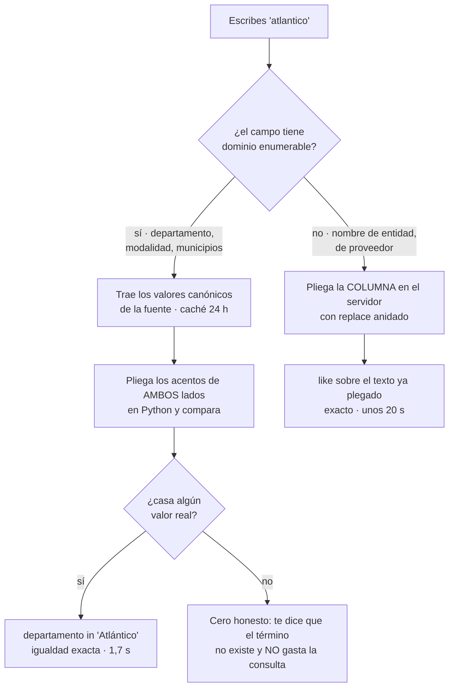

# colombia-datos-mcp

Servidor MCP para datos públicos de Colombia: catálogo nacional de
`datos.gov.co`, contratación pública (SECOP), criminalidad (MinDefensa),
división territorial con geometría (DIVIPOLA y MGN), registro mercantil (RUES),
estados financieros (Supersociedades), sanciones y antecedentes, educación
(ICFES y MinEducación), desempeño municipal (DNP) y TRM. **34 herramientas, sin
credenciales.**

Núcleo completo, adaptador de Socrata, motor de privacidad y siete familias de
datasets. Falta el adaptador SDMX y el de ArcGIS.

> **Si vas a citar una cifra de aquí, lee
> [Antes de citar una cifra](#antes-de-citar-una-cifra).** Estos datos tienen
> trampas que no se ven: contratos en borrador que suman, delitos que suben o
> bajan según el año que elijas de base, casos registrados que no son delitos
> cometidos, y un dataset llamado «Multas y Sanciones» en el que el 91 % de las
> filas son comentarios positivos.

> **Si vas a consultar a una persona, lee
> [Datos de personas](#datos-de-personas).** Tres de las fuentes traen nombres y
> cédulas. Agregar nunca pide permiso; identificar a alguien exige declarar para
> qué, y eso queda escrito en la respuesta.

## Instalación

```bash
pip install -e .
```

```bash
colombia-datos-mcp                      # stdio
colombia-datos-mcp --http --port 8080   # streamable HTTP
```

Requiere Python 3.11 o superior.

## Configuración en el cliente MCP

Claude Desktop o Claude Code:

```jsonc
{ "mcpServers": { "colombia-datos": {
    "command": "colombia-datos-mcp",
    "env": { "SOCRATA_APP_TOKEN": "opcional" } } } }
```

En Windows conviene apuntar al ejecutable con ruta absoluta
(`...\Scripts\colombia-datos-mcp.exe`): el cliente MCP no siempre hereda el
mismo `PATH` que tu terminal.

**No requiere credenciales.** `SOCRATA_APP_TOKEN` es opcional; sin él Socrata
limita por IP y el servidor lo advierte una vez en el sobre. El token viaja por
cabecera, nunca por query string, así que no aparece en logs ni en la URL
reproducible.

### Variables de entorno

Todas son opcionales y tienen valores conservadores.

| Variable | Defecto | Qué controla |
|---|---|---|
| `SOCRATA_APP_TOKEN` | — | Cuota propia en Socrata. Un token inválido produce `[CONFIG]`, no degradación silenciosa. |
| `CO_PRESUPUESTO_TOKENS` | `6000` | Tamaño máximo de respuesta, **pie incluido**: la procedencia, la URL reproducible y las advertencias cuentan. |
| `CO_TIMEOUT_CONTEO` | `25` (s) | Plazo del conteo de grupos. Si lo agota, el total sale «desconocido» y la respuesta llega igual con sus datos. |
| `CO_TIMEOUT_DOMINIO` | `20` (s) | Plazo para enumerar los valores de una columna categórica. Si lo agota, el filtro degrada a comparación de texto y el sobre lo dice. |
| `CO_TTL_DATOS` | `900` (15 min) | TTL de la caché en memoria. |
| `CO_TTL_METADATOS` | `86400` (24 h) | TTL de esquemas y dominios categóricos, en disco. |
| `CO_CACHE_DIR` | `~/.cache/colombia-datos-mcp` | Dónde vive la caché L2. |
| `CO_EXPORT_DIR` | `~/colombia-datos-export` | Único directorio donde `co_datos_exportar` puede escribir. |
| `CO_GEOMETRIA_URL` | réplica del MGN 2018 | De dónde bajar los límites municipales. Configurable porque la fuente oficial no publica capa municipal. Apuntarla a la capa departamental del IGAC NO funciona: los campos no casan y el adaptador lo rechaza. |
| `CO_REQ_POR_SEGUNDO` | `5` | Autolímite por host. |
| `CO_MAX_REINTENTOS` | `4` | Intentos por petición antes de rendirse. |
| `CO_USER_AGENT` | `colombia-datos-mcp/<versión> (+URL del repo)` | Identificación ante la fuente. |

## Qué devuelve: un ejemplo real

Pidiendo `co_geo_divipola(consulta="Itagui", limite=2)` —sin tilde, a propósito—
la respuesta completa es:

```markdown
| cod_dpto | departamento | cod_mpio | municipio | tipo | lon | lat |
|---|---|---|---|---|---|---|
| 05 | ANTIOQUIA | 05360 | ITAGÜÍ | Municipio | -75.612056 | 6.175079 |

**1 fila(s)** de **1** coincidencias · orden: `cod_mpio`

Fuente: `gdxc-w37w` DIVIPOLA - Códigos municipios · CC BY-SA 4.0

Consulta reproducible: https://www.datos.gov.co/resource/gdxc-w37w.json?%24where=nom_mpio+in+%28%27ITAG%C3%9C%C3%8D%27%29&%24order=cod_mpio&%24limit=2

> Los códigos DIVIPOLA son texto con ceros a la izquierda: consérvalos como string.
```

Todo lo que hay debajo de la tabla es **el sobre**, y es parte del contrato:

| Línea | Para qué sirve |
|---|---|
| `1 fila(s)` de `1` coincidencias | Si los dos números son iguales tienes el conjunto completo y puedes sumar. Si difieren, **estás viendo una parte**. Si el segundo número falta, no consta cuántos hay: ni es cero ni es lo que ves. |
| `orden: cod_mpio` | Sin orden declarado, «los 20 primeros» no significa nada. |
| `Fuente` + licencia | La atribución que debes propagar si republicas. |
| `Consulta reproducible` | El SoQL exacto que se ejecutó. Pégalo en el navegador y verifica: **es la prueba**. |
| Líneas con `>` | Advertencias del servidor. No son decorativas. |

Fíjate en la URL: escribí «Itagui» y el filtro salió `nom_mpio in ('ITAGÜÍ')`. Eso
es la resolución de nombres funcionando — ver
[Cómo se comparan los nombres](#cómo-se-comparan-los-nombres).

El **contenido estructurado** de la respuesta trae además `_meta`, con los
mismos datos en forma de objeto y uno que no cabe en la prosa:
`origen_del_total`, que dice si ese total se contó, si cupo entero o si la
colección era completa de por sí.

## Herramientas

| Herramienta | Qué hace |
|---|---|
| `co_datos_buscar_datasets` | Catálogo nacional; traduce siglas de entidad a la cadena de atribución exacta |
| `co_datos_describir_dataset` | Esquema en vivo: campo técnico + nombre legible + tipo + descripción |
| `co_datos_consultar` | SoQL; valida las columnas contra el esquema vivo; `detalle` = conteo / resumen / completo |
| `co_datos_agregar` | Agrupa del lado del servidor; `luego` encadena una segunda agregación sobre los grupos |
| `co_datos_serie` | Serie temporal sobre cualquier dataset; avisa si el último periodo está incompleto |
| `co_datos_perfilar` | Retrato de una columna: nulos, magnitudes y concentración |
| `co_secop_buscar_contratos` | Contratos de SECOP II |
| `co_secop_buscar_procesos` | Procesos de contratación |
| `co_secop_detalle_contrato` | Vista compuesta: contrato + adiciones + URL pública |
| `co_secop_perfil_proveedor` | Perfil agregado por cédula o NIT |
| `co_secop_resolver_entidad` | Nombre coloquial → nombre canónico + NIT |
| `co_secop_agregar` | Totales por departamento, entidad, modalidad, proveedor… |
| `co_geo_divipola` | Códigos y coordenadas de departamentos, municipios y centros poblados |
| `co_geo_cotejar_coordenadas` | Control de calidad entre las dos fuentes oficiales de coordenadas |
| `co_geo_limites` | Límites municipales o departamentales como GeoJSON, para dibujar mapas |
| `co_datos_exportar` | Descarga un filtro entero a CSV, JSON o Parquet en disco |
| `co_crimen_serie` | Serie temporal de un delito desde 2003, por año o por mes |
| `co_crimen_por_municipio` | Municipios con más casos de un delito en un año |
| `co_crimen_comparar` | Varios delitos entre dos años, ordenados por variación |
| `co_dossier_documento` | **Todo lo que el servidor sabe de un NIT**: RUES + SECOP + finanzas + 4 fuentes de sanciones, y qué miró |
| `co_empresas_buscar` | RUES por razón social o documento; 9,4 M de matrículas |
| `co_empresas_ficha` | Ficha mercantil de un documento: matrícula, forma jurídica, establecimientos, ranking |
| `co_empresas_estados_financieros` | Activos, pasivos, patrimonio, ingresos y resultado reportados a Supersociedades |
| `co_empresas_ranking` | Las más grandes por ingresos, activos, patrimonio o ganancia |
| `co_integridad_screening` | Un documento contra las cinco fuentes de sanciones, enumerando lo que miró |
| `co_integridad_disciplinarias` | Sanciones del SIRI por documento, nombre o entidad |
| `co_integridad_panorama` | El reparto de las sanciones del SIRI, sin identificar a nadie |
| `co_integridad_sanciones_contratacion` | Multas de SECOP I y II a contratistas |
| `co_educacion_saber11` | Promedios de Saber 11 agregados por territorio, colegio o condición social |
| `co_educacion_indicadores` | Cobertura, deserción, aprobación y repitencia por municipio |
| `co_territorio_desempeno` | Índice de Desempeño Municipal del DNP |
| `co_macro_trm` | TRM de una fecha, de un rango, o la última certificada |
| `co_macro_convertir` | Un monto entre pesos y dólares a la TRM de una fecha |
| `co_macro_tasas` | Tasas de captación por producto, con el aviso de que el promedio no está ponderado |

Más seis *resources*: `co://secop/datasets`, `co://secop/joins`,
`co://atribuciones`, `co://privacidad/politica`, `co://fuentes/familias` y
`co://sin-fuente-abierta`.

**Parámetros, topes y advertencias de cada una:
[docs/herramientas.md](docs/herramientas.md).** Secuencias que funcionan, con sus
trampas: [docs/recetas.md](docs/recetas.md).

## Datos de personas

Tres de las fuentes del servidor traen personas identificadas:

| Fuente | Qué trae |
|---|---|
| RUES (`c82u-588k`) | 6.962.889 de sus 9.436.330 matrículas son de personas naturales, con nombre, apellidos y cédula |
| SIRI (`iaeu-rcn6`) | 42.124 sanciones disciplinarias con nombre completo, cédula y cargo |
| Saber 11 (`kgxf-xxbe`) | 7.109.704 registros individuales con género, fecha de nacimiento, estrato y escolaridad de los padres |

Son datos abiertos publicados por el Estado bajo licencia CC. Eso los hace
legales de consultar; no los hace inocuos de volcar en una conversación que
queda guardada. El motor de privacidad (`core/privacidad.py`) impone tres
reglas:

**1. Agregar nunca pide permiso.** `co_integridad_panorama` reparte las 42.124
sanciones por entidad, departamento, tipo de sanción o calidad de la persona, y
`co_educacion_saber11` promedia por territorio, colegio o estrato. Son preguntas
sobre poblaciones y no pasan por el motor. Que el camino barato sea también el
que no identifica a nadie es deliberado.

**2. Identificar a una persona natural exige declarar `finalidad`.** Las cuatro
válidas son `investigacion`, `periodismo`, `control_fiscal` y
`debida_diligencia`. No es un trámite: la finalidad viaja al sobre y queda en la
respuesta, así que la consulta es auditable por quien la lea después.

```
co_empresas_ficha(documento="1023456789")
→ [PRIVACIDAD] La ficha de 10••••••89 identifica a una persona natural, así que
  hay que declarar `finalidad`. No la supongas: pregúntasela a quien te lo pidió.
  Sugerencia: declara una de control_fiscal, debida_diligencia, investigacion,
  periodismo, o responde sin identificar a nadie con co_empresas_buscar con
  solo_juridicas=True si lo que buscas es una sociedad.
```

El error **siempre nombra la alternativa agregada**. Un bloqueo que no dice qué
hacer en su lugar enseña al modelo a reintentar con otras palabras hasta colarse.

**3. Quién relaja la política es el operador, no el modelo.** `CO_PRIVACIDAD` es
variable de entorno, y ninguna herramienta recibe un parámetro que la afloje: no
hay forma de que un prompt lo pida. Un valor mal escrito cae del lado que
protege.

Los documentos salen enmascarados conservando los dos primeros y los dos últimos
dígitos (`1023456789` → `10••••••89`), lo que deja comprobar que dos filas
hablan de la misma persona sin escribir el número. **El NIT de una sociedad no
se enmascara**: es información mercantil pública y ocultarlo dejaría la
respuesta inútil para cruzarla con SECOP.

La máscara cubre las celdas, el **texto** —títulos, avisos, mensajes de error— y
la **consulta reproducible** del pie. Las tres cosas, porque enmascarar la
columna y escribir el número completo cuatro líneas más abajo no protege nada.
En una consulta nominal la URL publicada deja por eso de ser ejecutable tal
cual, y la respuesta lo dice: se conserva el dataset, el resto del filtro y la
forma de la consulta, y se va el número, que lo tiene quien preguntó.

Y se decide fila por fila: una página del RUES con una persona natural y cuatro
sociedades enmascara una cédula y deja los cuatro NIT visibles.

### La política la impone la fuente, no la herramienta

Las personas están en el dataset, no en la vía de acceso. `co_datos_consultar`,
`co_datos_agregar` y `co_datos_exportar` aceptan cualquier `dataset_id`, así que
si el motor viviera solo en las herramientas especializadas bastaría con venir
por ahí: pedir `iaeu-rcn6` con `detalle="completo"` devolvía el SIRI entero con
nombre y cédula. Las tres vías genéricas pasan ahora por la misma puerta y
aceptan `finalidad`.

Dos consecuencias que conviene conocer:

- **Saber 11, Saber Pro y Saber TyT no salen fila a fila por ninguna vía**, y no
  hay finalidad que lo abra: una fila es un estudiante con su estrato y la
  escolaridad de sus padres. Agregados, sin límite.
- **Agrupar por documento cuenta como identificar.** `agrupar_por="numero_
  identificacion"` devuelve una fila por persona, así que pide finalidad y la
  clave de grupo sale enmascarada. Agrupar por entidad, departamento o año no
  pide nada.

Lo que esta puerta **no** cubre: los contratos de SECOP, donde el proveedor de
una prestación de servicios es una persona natural con su cédula. Son fuentes
anteriores al motor y las exponen diecinueve herramientas.

### Cómo se decide si un documento es de una persona

Hay dos señales y **ninguna es infalible**, así que se cruzan:

- **`categoria_matricula` del RUES** es la buena: atrapa a los 517.527
  comerciantes a título personal que figuran con clase de identificación `NIT`
  y que la forma del número daría por empresas.
- **La forma del documento** atrapa el error contrario. Y existe: el NIT de
  **Bancolombia** (890903938) tiene dos matrículas, la de Medellín como
  sociedad anónima y **la de Cali clasificada como `PERSONA NATURAL`**, con la
  razón social del banco escrita en la fila.

La primera versión bloqueaba en cuanto una matrícula dijera persona natural,
por quedarse del lado que protege. El efecto real fue dejar la herramienta
inútil para su caso central: pedir la ficha de uno de los bancos más grandes
del país devolvía `[PRIVACIDAD]`. Lo descubrió la primera llamada contra la
fuente viva, no las pruebas.

La regla que quedó: **manda la fuente, salvo que el documento tenga forma
inequívoca de NIT de empresa** —nueve dígitos empezando por 8 o 9, un rango al
que la numeración de cédulas no llegó nunca—. Y cuando las dos señales
discrepan **no se resuelve en silencio**: la fila se conserva y el sobre dice
que la fuente la tiene mal clasificada, porque eso es información sobre el
dato. Hay prueba de contrato que vigila el caso de referencia.

Esto no anonimiza, y conviene no confundirlo: enmascarar un documento no impide
reidentificar a alguien cuyo nombre, cargo y municipio van en la misma fila.
Sirve para que el número no quede escrito en un historial, que es un riesgo
distinto y real.

La política vigente se puede leer sin provocar un error, en el *resource*
`co://privacidad/politica`.

## Tres fuentes que están aquí para poder decir que no sirven

Lo contrario de lo que haría un catálogo comercial, y es el punto. Un cero en
una fuente de antecedentes se lee como un certificado limpio, así que el
servidor nunca devuelve un cero desnudo:

**SECOP II «Multas y Sanciones» (`it5q-hg94`) no es un registro de sanciones.**
De sus 588 filas, **533 son «Comentarios positivos»** y 55 negativos. Y solo 145
están publicadas: 379 esperan aprobación, 33 fueron rechazadas y 31 son
borradores. Es la tabla de retroalimentación de proveedores. Para colmo,
`as_codigo_proveedor_objeto` es un código interno de la plataforma y no el NIT,
así que no se puede cruzar por documento: solo por nombre.

**SIRI casi no tiene contratistas.** De 42.124 sanciones, 26.091 son a miembros
de la fuerza pública y 15.736 a servidores públicos. **18 son a contratistas** y
8 a particulares. Es una fuente excelente para estudiar la sanción disciplinaria
del Estado a sus propios funcionarios, y está vacía en la práctica para
verificar a un proveedor.

**La Responsabilidad Fiscal de la Contraloría (`jr8e-e8tu`) tiene 60 filas** y
está parada desde el 23-mar-2022. No es el Boletín de Responsables Fiscales.

Ninguna de las tres se oculta, porque entonces la pregunta «¿tiene sanciones?»
se quedaría sin respuesta y parecería que el servidor no mira ahí. Se exponen
con la cifra al lado.

## Antes de citar una cifra

Esto es lo que el servidor **no puede decidir por ti**. Las tres primeras valen
para cualquier dato; las demás son de su fuente.

### Para cualquier consulta

**1. Comprueba `devueltos` contra `total`.** Si el sobre dice «20 filas de 4.312
coincidencias», sumar esas 20 no da el total de nada. Usa una herramienta de
agregación. El servidor te lo advierte, pero no puede impedírtelo. En una
agregación el `total` cuenta **grupos**, y si sale `desconocido` es literal: la
fuente no dejó contarlos, así que puede haber más de los que ves.

Cada total viene con `origen_del_total`, que dice **cómo se supo**: `contado`
(lo contó la fuente), `cabia_entero` (devolvió menos de lo pedido, así que no
había más) o `completo` (la colección no sale de una consulta con `$limit`: las
columnas de un esquema, un contrato concreto). Si vas a citar la cifra, ese
campo es la diferencia entre un dato y una suposición.

**2. Cuenta antes de traer.** `detalle="conteo"` cuesta ~200 tokens y te dice si
el filtro está bien antes de gastar miles en filas.

**3. No mezcles unidades de análisis.** Un contrato no es un proceso, y una
adición no es un contrato: hay **26,1 M de adiciones para ~5,9 M de contratos**.
Cada respuesta declara su unidad; sumar filas de dos datasets distintos produce
un número sin significado. Lo mismo en criminalidad: MinDefensa publica 37
datasets con **idéntico esquema** de los que solo 23 cuentan delitos — en
`ERRADICACIÓN` la `cantidad` son hectáreas. El esquema igual no garantiza que se
puedan sumar.

### Contratación pública

**4. Los contratos en `Borrador` están en el dataset y suman.** No están
firmados —no traen `fecha_de_firma` y su `valor_pagado` es 0—, pero cuentan en
`sum(valor_del_contrato)`. Si lo que te interesa es contratación real, filtra por
estado. En un caso real que motivó esta nota, el borrador era $93.192.634 de un
total de $547.285.071: un **17 %** de la cifra que se habría citado.

**5. `sum(valor_del_contrato)` sin acotar no sirve para nada.** De los 5.958.553
contratos de SECOP II, **9 aportan el 94 % de la suma**. Son errores de
digitación: el mayor son 881,8 *trillones* de pesos —unas 560.000 veces el PIB
de Colombia— para una institución universitaria. Y no hace falta irse a los
extremos: en la banda de 1 a 10 billones hay contratos de **un enfermero por
9,97 billones** y de **un higienista oral por 9,65 billones**.

Ampliando a los 3.452 contratos por encima del billón, aportan el **99,99998 %**
del total. Dos cosas que ayudan a identificarlos: el **100 %** tiene
`valor_pagado = 0`, y el 97 % está en `Cancelado` o `Borrador`.

**Pero filtrar por estado NO basta.** Excluyendo cancelados y borradores
sobreviven 83 atípicos, y siguen dominando la suma entera. Hay que acotar por
magnitud, con `valor_max`. Las tres cifras defendibles:

| Qué mides | Contratos | Suma |
|---|---|---|
| Valor contratado, sin los imposibles | 5.955.101 | **$997,5 billones** |
| Ídem, sin cancelados ni borradores | 5.602.420 | **$855,8 billones** |
| Efectivamente **pagado** | 2.826.295 | **$251,6 billones** |

La última es la más honesta si lo que te interesa es dinero que se movió. Las
herramientas de agregación advierten con los números de tu filtro, pero la
decisión de excluir es tuya.

**6. Los montos son nominales y sin deflactar.** Comparar $575.132 de 2018 con
$93 millones de 2026 no dice nada por sí solo.

**7. Confirma que un nombre es una sola persona.** Dos personas distintas con el
mismo nombre se mezclan sin aviso. Agrupa por `documento_proveedor` antes de dar
un total por nombre; si sale más de una cédula, son varias personas.

**8. Casi todo es solo SECOP II.** Para contratación anterior a la plataforma hay
que consultar también `rpmr-utcd` (SECOP Integrado). Un «cero contratos» puede
significar «no está en SECOP II», no «no contrató nunca».

### Antes de fiarte de una columna

```
co_datos_perfilar(dataset_id="jbjy-vk9h", campo="valor_del_contrato")
```

```markdown
- Rango: 0 a 881.804.150.601.557.082.112
- Los 10 valores mayores aportan el 95,5 % de la suma.

| Por encima de | Filas |
|---|---|
| 1.000.000.000 | 101.292 |
| 1.000.000.000.000 | 3.452 |
| 1.000.000.000.000.000.000 | 41 |

> ATENCIÓN: 10 filas de 5.958.553 aportan el 95,5 % de la suma. Una suma así
> no describe al conjunto: revisa si son valores reales o errores de digitación.
```

Ese reparto por orden de magnitud es lo que delata una segunda población dentro
de una columna. Descubrirlo a mano costó una investigación entera; ahora cuesta
una llamada.

Y `co_datos_serie` cubre el otro error clásico: **avisa cuando el último periodo
está incompleto**, que es lo que convierte «2026» en una caída del 30 % que no
existe. No da falsa alarma si el periodo sí está cerrado, y **rechaza las
columnas de fecha que en realidad son texto** —las cinco del Plan Anual de
Adquisiciones— donde agrupar falla y `between` miente.

## Dibujar un mapa

```
co_geo_limites(nivel="municipio", departamento="Chocó")
```

Devuelve los polígonos como GeoJSON en el **contenido estructurado**, no en el
texto: un polígono no se lee en una tabla y se comería el presupuesto de tokens.
El cuerpo trae el resumen —código, nombre y extensión de cada uno—.

Filtra con `codigo` (DIVIPOLA de 2 o 5 dígitos) o `departamento`. Por encima de
200 geometrías hay que acotar o usar `guardar`, que las escribe en disco: 1.122
polígonos en una respuesta revientan al cliente.

Con `nivel="departamento"` agrupa los municipios de cada uno en un MultiPolygon.
**No es una disolución real** —las aristas internas siguen ahí— y el sobre lo
advierte: relleno se ve igual, pero si trazas el borde aparecen las divisiones.

Como el identificador es la clave DIVIPOLA, une por código con el resto del
servidor sin pasar por el nombre, que es donde se pierden Cali, Cartagena y
Cúcuta.

**La geometría está muy simplificada**: mediana de 10 vértices por municipio.
Sirve para colorear un mapa nacional, no para medir áreas ni para resolver si un
punto cae dentro cerca de un límite. Va advertido en cada respuesta.

## Criminalidad

**9. Son casos registrados, no delitos cometidos.** Una subida en extorsión, en
delitos sexuales o en violencia intrafamiliar puede ser **más denuncia y no más
delito**: el alza del 1.153 % en intrafamiliar desde 2003 mide sobre todo cuánto
se denuncia hoy. El homicidio es el indicador menos sensible a eso —un muerto es
difícil de no registrar— y es, con diferencia, el que menos subió.

**10. El año base decide el titular.** El secuestro **subió 259 %** contra 2017 y
**bajó 67 %** contra 2003. Es la misma serie: 2.121 casos en 2003, 195 en 2017,
701 en 2025. Las dos frases son ciertas. Mira la serie completa con
`co_crimen_serie` antes de citar cualquier porcentaje; la herramienta te devuelve
el máximo y el mínimo justo para eso.

**11. Sin población no hay tasas.** La fuente no publica proyecciones
municipales —se buscaron, incluido el facet del DANE, y no están—, así que un
ranking de municipios por casos es casi un ranking de municipios grandes, y un
mapa de conteos es casi un mapa de dónde vive la gente.

**12. Cada dataset corta por su cuenta**, y la fecha cambia con cada recarga.
Comparar ese año a medias con años cerrados es la forma más fácil de inventarse
una caída. El servidor consulta `max(fecha_hecho)` y lo advierte.

**13. `cantidad` no vale uno.** Un hecho puede tener varias víctimas: homicidio
tiene 345.195 filas y 345.917 víctimas. Se suma `cantidad`, nunca se cuentan
filas. Y la serie de los dos hurtos **se rompe en 2017**, cuando ambas cifras más
que se duplican y el homicidio se queda plano: comparar contra 2016 mide la
ruptura, no el delito.

Y una que el servidor sí garantiza: **cero filas nunca es lo mismo que fuente
caída.** Son mensajes distintos a propósito. Un `[FUENTE_CAIDA]` no significa
«no hay datos», y una tabla vacía no es un fallo.

## Extraer los datos

Tres vías, según lo que quieras hacer con ellos.

**Contenido estructurado, en cada respuesta.** Además del markdown, toda
herramienta devuelve por el canal estructurado del protocolo un objeto con
`datos` —las filas ya tipadas: las coordenadas son `float`, no texto— y `_meta`
con el total, el orden, las advertencias y la URL reproducible. Un cliente MCP
puede consumirlas como datos sin volver a parsear la tabla.

**`formato` para copiar y pegar.** Las herramientas de consulta aceptan
`formato="csv"` o `"json"`; el cuerpo sale en un bloque cercado para que se
copie limpio, y el sobre sigue debajo con su procedencia.

```
co_secop_buscar_contratos(departamento="Chocó", formato="csv")
```

**`co_datos_exportar` para volúmenes.** Pagina hasta agotar el filtro y escribe
el fichero, así que sirve para lo que no cabe en una respuesta. Devuelve la ruta,
el número de filas y si el conjunto quedó completo.

```
co_datos_exportar(dataset_id="jbjy-vk9h", nombre_archivo="contratos_choco",
                  donde="departamento = 'Chocó'", formato="csv")
```

Es la **única herramienta que escribe** y está anotada como tal, para que el
cliente pueda pedirte confirmación. `nombre_archivo` es un nombre, no una ruta:
el fichero se escribe siempre bajo `CO_EXPORT_DIR`, y cualquier intento de salir
de ahí se neutraliza. El CSV lleva BOM para que Excel respete los acentos; con
pandas usa `encoding="utf-8-sig"`.

## Gráficas

Las agregaciones traen una columna de barras proporcionales a la métrica, para
comparar los grupos sin salir de la terminal. Municipios por departamento:

```
co_datos_agregar(dataset_id="gdxc-w37w", agrupar_por="dpto", limite=6)
```

```markdown
| dpto | total | gráfica |
|---|---|---|
| ANTIOQUIA | 125 | ████████████████ |
| BOYACÁ | 123 | ███████████████▊ |
| CUNDINAMARCA | 116 | ██████████████▉ |
| SANTANDER | 87 | ███████████▏ |
| NARIÑO | 64 | ████████▎ |
| TOLIMA | 47 | ██████ |
```

Todas comparten escala —eso es lo que las hace comparables— y usan bloques de un
octavo, así que 87 y 64 se distinguen sin leer los números. Un valor no numérico
deja la celda vacía en vez de dibujar una barra de cero. Se apagan con
`grafica=false` y no aparecen si pides `formato="csv"` o `"json"`.

### Cuando la gráfica delata el dato

Las mismas barras sobre `metrica="valor"` en SECOP dan esto:

```
co_secop_agregar(agrupar_por="departamento", metrica="valor", limite=3)
```

```markdown
| departamento | contratos | valor total | gráfica |
|---|---|---|---|
| Antioquia | 563.810 | $4.712.182.461.396.660.781.056 | ████████████████ |
| Distrito Capital de Bogotá | 2.002.976 | $216.174.625.284.825.972.736 | ▊ |
| Arauca | 25.550 | $48.653.538.638.823.145.472 | ▏ |
```

Bogotá tiene **cuatro veces más contratos** que Antioquia y una barra veinte
veces menor. Eso no es un fallo de dibujo: es la regla 5 hecha visible. Fue así
como aparecieron los 3.452 contratos con valores imposibles, y por eso ahora la
respuesta trae el aviso con las cifras del filtro.

Una gráfica que no cuadra con lo que sabes del mundo es información, no ruido.

## Antes de fiarte de una columna

```
co_datos_perfilar(dataset_id="jbjy-vk9h", campo="valor_del_contrato")
```

```markdown
- Rango: 0 a 881.804.150.601.557.082.112
- Los 10 valores mayores aportan el 95,5 % de la suma.

| Por encima de | Filas |
|---|---|
| 1.000.000.000 | 101.292 |
| 1.000.000.000.000 | 3.452 |
| 1.000.000.000.000.000.000 | 41 |

> ATENCIÓN: 10 filas de 5.958.553 aportan el 95,5 % de la suma. Una suma así
> no describe al conjunto: revisa si son valores reales o errores de digitación.
```

Ese reparto por orden de magnitud es lo que delata una segunda población dentro
de una columna. Descubrirlo a mano costó una investigación entera; ahora cuesta
una llamada.

Y `co_datos_serie` cubre el otro error clásico: **avisa cuando el último periodo
está incompleto**, que es lo que convierte «2026» en una caída del 30 % que no
existe. No da falsa alarma si el periodo sí está cerrado, y **rechaza las
columnas de fecha que en realidad son texto** —las cinco del Plan Anual de
Adquisiciones— donde agrupar falla y `between` miente.

## Dibujar un mapa

```
co_geo_limites(nivel="municipio", departamento="Chocó")
```

Devuelve los polígonos como GeoJSON en el **contenido estructurado**, no en el
texto: un polígono no se lee en una tabla y se comería el presupuesto de tokens.
El cuerpo trae el resumen —código, nombre y extensión de cada uno—.

Filtra con `codigo` (DIVIPOLA de 2 o 5 dígitos) o `departamento`. Por encima de
200 geometrías hay que acotar o usar `guardar`, que las escribe en disco: 1.122
polígonos en una respuesta revientan al cliente.

Con `nivel="departamento"` agrupa los municipios de cada uno en un MultiPolygon.
**No es una disolución real** —las aristas internas siguen ahí— y el sobre lo
advierte: relleno se ve igual, pero si trazas el borde aparecen las divisiones.

Como el identificador es la clave DIVIPOLA, une por código con el resto del
servidor sin pasar por el nombre, que es donde se pierden Cali, Cartagena y
Cúcuta.

**La geometría está muy simplificada**: mediana de 10 vértices por municipio.
Sirve para colorear un mapa nacional, no para medir áreas ni para resolver si un
punto cae dentro cerca de un límite. Va advertido en cada respuesta.

## Criminalidad

23 datasets de MinDefensa con esquema común (`cod_muni`, `fecha_hecho`,
`cantidad`): homicidio, extorsión, secuestro, hurtos, violencia intrafamiliar,
delitos sexuales, terrorismo, trata de personas, delitos informáticos y más.

Tres cosas que el módulo decide por ti, y conviene saber por qué:

**Solo delitos, nunca operativos.** MinDefensa publica 37 datasets con ese mismo
esquema, pero los de incautación y erradicación miden otra cosa: en
`ERRADICACIÓN` la `cantidad` son **hectáreas**, y en las incautaciones la columna
`unidad` trae valores como `0.002`. Sumarlos junto a homicidios sería sumar kilos
con personas, así que no están en el registro.

**Se suma `cantidad`, nunca se cuentan filas.** Un hecho puede tener varias
víctimas: homicidio tiene 345.195 filas y 345.917 víctimas.

**Los dos hurtos fueron el mismo dato hasta octubre de 2026.** «HURTO A
COMERCIO» servía la serie de «HURTO A RESIDENCIAS» —cifras idénticas año por
año— y el registro advertía de no sumarlos. MinDefensa recargó la familia el
21-oct-2026 y hoy son dos series sin un año en común, así que sumarlos es
legítimo; una descarga anterior a esa fecha, no. Lo que sí queda en pie es que
las dos series **se rompen en 2017**: más que se duplican en un año mientras el
homicidio se queda plano.

### El año base no es neutral

El secuestro **subió 259 %** contra 2017 y **bajó 67 %** contra 2003. Es la misma
serie: 2.121 casos en 2003, 195 en 2017, 701 en 2025.

Por eso `co_crimen_serie` devuelve el máximo y el mínimo de la serie junto a los
datos, y `co_crimen_comparar` recuerda que la elección del año cambia el
resultado. Un porcentaje sin su serie es técnicamente cierto y sustancialmente
engañoso.

Y sobre todo: **son casos registrados, no delitos cometidos.** Una subida en
extorsión o violencia intrafamiliar puede ser más denuncia y no más delito. El
homicidio es el indicador menos sensible a eso. Va advertido en cada respuesta.

## Cómo se comparan los nombres

Es la pieza menos obvia del servidor, y nació de un defecto medido.

Las columnas **categóricas de la fuente conservan los acentos** —`departamento`
es `Atlántico`, `nom_mpio` es `MEDELLÍN`—, y SoQL no tiene `unaccent()`: su
`like` distingue acentos. La estrategia se elige por la cardinalidad del campo:

| Caso | Estrategia | Por qué |
|---|---|---|
| Dominio enumerable (`departamento`, `modalidad`, municipios) | Se traen los valores canónicos (cacheados 24 h), se resuelve el término en Python y se filtra con `in ('Atlántico')` | Exacto, y compara por igualdad: 1,7 s frente a 7-20 s |
| Texto libre (`nombre_entidad`, `proveedor_adjudicado`) | El plegado se hace **en el servidor**, con `replace()` anidado sobre la columna | No hay lista que enumerar; exacto y de coste constante en la longitud del término |



La rama de la izquierda es la que faltaba antes: un término que no corresponde a
ningún valor real no se consulta, se explica. Un cero silencioso es
indistinguible de «no hay datos».

Se descartaron dos alternativas por medición contra los 1.122 municipios reales,
no por intuición: los comodines sobre las vocales alcanzaban el 100 % de recall
pero contaminaban el 32 % de las consultas —«ANDES» casaba con «CALDAS»—, y un
solo comodín por posición bajaba el ruido al 18 % pero perdía los nombres con dos
tildes («ITAGÜÍ», «EL PEÑÓN»). Las tres mediciones están en
`tests/test_texto.py`.

En la práctica: **escribe los nombres con tilde o sin ella, da igual.**

Lo que sí importa es el **orden de las palabras**: el filtro busca la cadena
completa como subcadena. La fuente suele guardar a las personas como
`APELLIDO1 APELLIDO2 NOMBRE1 NOMBRE2`, así que buscar el nombre en orden natural
devuelve cero. Si un nombre de persona da cero, prueba solo con los apellidos.

## Qué hace distinto

**El contrato de respuesta.** Toda respuesta trae el sobre del ejemplo de arriba,
con la URL exacta reproducible.

**Presupuesto de tokens con degradación explícita.** Si la respuesta no cabe, se
recorta y se marca `truncado: true` con instrucciones de qué hacer. Nunca hay
truncamiento silencioso.

**Paginación honesta.** `siguiente_offset` se calcula sobre lo realmente
devuelto, nunca sobre lo descargado. Y el orden estable se fuerza ya en la
primera página: si la página 1 no tiene orden, la 2 no puede tenerlo.

**Errores tipados.** `[VALIDACION]`, `[FUENTE_CAIDA]`, `[LIMITE_TASA]`,
`[NO_ENCONTRADO]`, `[TIMEOUT]`, `[CONFIG]`, cada uno con una sugerencia
accionable.

**Esquema en vivo, nunca cableado.** Las columnas se validan contra el esquema
real; un campo inexistente se rechaza listando los válidos.

**Cero honesto.** Cuando un término categórico no existe en la fuente, el
servidor lo dice con esas palabras y **no gasta la consulta**. Una tabla vacía es
indistinguible de «no hay datos».

## Trampas de la API que el servidor absorbe por ti

No tienes que hacer nada con esta lista: está aquí para que se sepa qué hay
debajo, y porque cada punto costó una verificación contra la fuente viva.

- `search_context` es obligatorio en la Discovery API o `categories`/`tags`
  devuelven **0 en silencio**.
- El facet `attribution` solo acepta la cadena literal completa.
  `attribution=DANE` da cero; hay que usar `Departamento Administrativo Nacional
  de Estadísticas - DANE, Bogotá D.C.` — con «Estadísticas» en plural, que no es
  el nombre real de la entidad.
- `$order` es obligatorio al paginar o se pierden y duplican filas. Pero **no se
  puede ordenar por `:id` una consulta agregada**: Socrata responde «Column
  ':id' is not in group by».
- Los números llegan como **string**; los códigos DIVIPOLA son texto con ceros a
  la izquierda (`05`, `08`). Tratarlos como enteros rompe todos los joins.
- **Socrata omite los campos nulos** en vez de mandarlos vacíos, así que dos
  filas del mismo dataset llegan con juegos de claves distintos. Deducir las
  columnas de la primera fila perdía datos en silencio.
- Los acentos vienen destruidos en origen **solo en el texto libre**
  (`descripcion` trae `EJECUCIoN`); las columnas categóricas los conservan. Dar
  por buena la primera mitad y aplicarla a todo dejaba 392 de 1.122 municipios,
  12 de 33 departamentos y ~2,8 M de contratos inalcanzables por nombre.
- **SoQL sí soporta `replace()` anidado.** Una prueba con `curl` sugería lo
  contrario, pero era el shell corrompiendo el acento, no la API.
- **Coordenadas:** en `xaxy-8nri` exactamente un registro de 8.161 —Medellín—
  trae separador de miles (`-75,581,775`), y `float(s.replace(",", "."))` **lanza
  `ValueError`** sobre él. `core/coords.py` aplica «la primera coma es el
  decimal» y valida contra la caja envolvente del país. Cuidado: esa regla es
  correcta para coordenadas y **falsa para dinero**, donde `1.000.000` es un
  millón.
- Las «modificaciones contractuales» se llaman **Adiciones**; buscar
  «modificaciones» en el catálogo devuelve cero.
- Varias entidades se registran en SECOP con su **sigla y nada más**: INVIAS y
  UNGRD figuran así, y expandirlas a su razón social da cero. **RTVC** no está en
  el dataset de contratos con ningún nombre, solo en SECOP Integrado.
- Las columnas de fecha del Plan Anual de Adquisiciones (`9sue-ezhx`) son de tipo
  `text`, no `calendar_date`: no se filtran con `between`.
- **El catálogo de funciones SoQL de datos.gov.co no es el de la documentación
  general de Socrata.** Verificado contra la fuente: `caseless_eq` y
  `date_diff_d` **sí** existen; `char_length`, `is_empty`, `to_number` y
  `not_like` **no**. Por eso el servidor ya no valida contra una lista de
  funciones —siempre estaría incompleta o de más—: deja que la fuente decida y
  se limita a comprobar las columnas.
- **`count(*)` no cuenta grupos.** Sobre una consulta agrupada devuelve el tamaño
  de cada grupo, no cuántos hay, y con `$having` no hay forma de saber cuántos
  sobreviven al filtro. Se resuelve encadenando etapas con el operador `|>` de
  SoQL, que exige `$query` porque `$select`/`$group` sueltos no lo admiten. Es
  el parámetro `luego` de `co_datos_agregar`.
- **Un NIT no es una entidad, es un organismo con chequera.** En SECOP, `899999061`
  cubre las **34 secretarías de Bogotá**, `899999034` los **78 centros del SENA**,
  `899999239` las 32 regionales del ICBF, `890399011` las 28 dependencias de Cali
  y `899999114` las 18 de Cundinamarca. Agrupar por `nit_entidad` los funde en uno
  y agrupar por `nombre_entidad` los separa: ninguna de las dos es «la entidad».
  Elige según la pregunta y dilo — quien pasa de la Secretaría de Ambiente a la de
  Gobierno de Bogotá no cambió de empleador, pero sí de contrato.
- **El mismo NIT está cargado con y sin dígito de verificación.** `899999061` y
  `8999990619` son Bogotá; `899999034` y `8999990341`, el SENA. Son 92 parejas que
  tocan el **28,9 %** de los contratos de prestación de servicios de 2026, así que
  filtrar por una sola forma pierde la mitad de los organismos y agrupar sin
  fusionarlas infla cualquier conteo de «contratista en varias entidades» (41.413
  → 41.070). Las herramientas de SECOP buscan las dos formas y lo advierten;
  `core/nit.py` calcula el dígito con el algoritmo de la DIAN y **no toca las
  cédulas**: a una de cada once de diez dígitos le cuadra por azar.
- **La fecha de «actualizado» del catálogo no es la de los datos.** `updatedAt` es
  el máximo entre `data_updated_at` y `metadata_updated_at`, así que un retoque de
  la ficha se presenta como actualización. Verificado: los indicadores de
  mortalidad del MinSalud (`4e4i-ua65`) figuran actualizados en septiembre de 2026
  con los datos parados desde **agosto de 2022**, y la Medición del Desempeño
  Municipal del DNP (`nkjx-rsq7`) desde febrero de 2022. Cientos de datasets
  comparten además el sello `2026-05-18`, que fue una migración masiva de
  metadatos del portal. El servidor publica la fecha de los datos y avisa cuando
  las dos divergen, pero para saber hasta dónde llega una serie **hay que
  preguntarle al dato**, no a la ficha: `max()` sobre su columna de periodo.
- **`orden` y `rama` no sirven para filtrar por nivel de gobierno.** El error es
  sistemático, no por contrato suelto: el ITM —institución municipal de Medellín—
  figura como `orden='Nacional'` en sus 15.482 contratos de 2026, las CAR salen
  unas nacionales y otras territoriales, y la JEP o la CNSC aparecen con
  `rama='Corporación Autónoma'`. 36 NIT tienen más de un valor de `orden`. Para
  «entidades nacionales» hay que cruzar por NIT con el Universo de entidades de
  Función Pública (`h7zv-k39x`), separando las CAR y completando las unidades con
  NIT propio de la Fuerza Pública y las seccionales de la Rama Judicial.

## Lo que este servidor NO hace

Explícito para que nadie lo dé por hecho:

- **No degrada entre niveles de detalle.** Ante una respuesta grande recorta
  filas; no baja de `completo` a `resumen` por su cuenta.
- **No da tasas por 100.000 habitantes**, porque no hay población municipal
  total: el DANE no publica las proyecciones por API y bajo su atribución en
  `datos.gov.co` hay exactamente dos datasets, los dos de DIVIPOLA. Lo más
  cercano es la población de 5 a 16 años del MinEducación, que no sirve de
  denominador. Hay prueba de contrato que vigila si eso cambia.
- **No deflacta.** Ni el DANE ni el Banco de la República publican el IPC por
  API REST abierta. `co_macro_convertir` da una segunda unidad verificable
  —dólares de la fecha del contrato— y la respuesta aclara que convertir no es
  deflactar: el dólar también cambia de valor.
- **No consulta procesos judiciales, Registraduría, RUNT, SIMIT ni el Boletín de
  Deudores Morosos**: solo se consultan por formulario web con captcha, y este
  servidor se define como «sin credenciales».
- **No expide certificados de antecedentes.** Las fuentes de sanciones son
  incompletas y con rezago; un cero en ellas no limpia a nadie.
- **No cubre Banco de la República**: falta el adaptador SDMX.
- **No tiene adaptador ArcGIS**, y no por falta de tiempo: el servicio del IGAC
  se evaluó el 05-nov-2026 y no publica capa municipal. La geometría viene de
  una réplica del MGN 2018 del DANE.
- `ESQUEMA_CAMBIADO` y `FUERA_DE_JURISDICCION` están definidos como errores pero
  **ningún camino de código los lanza todavía**. `PRIVACIDAD` sí, desde 0.16.0.

Todo esto está también en el *resource* `co://sin-fuente-abierta`, para que el
modelo lo pueda leer en vez de buscar un sustituto que no lo es.

Detalle en [docs/arquitectura.md](docs/arquitectura.md#lo-que-todavía-no-hace).

## Si editas el código

El cliente MCP lanza el servidor como un proceso hijo de larga vida, y **Python
no recarga módulos en caliente**. Un proceso arrancado antes de tu cambio seguirá
ejecutando el código viejo indefinidamente, aunque la instalación sea editable y
las pruebas pasen.

Para confirmarlo, mira la `Consulta reproducible` del sobre: muestra el SoQL que
el proceso generó de verdad. Si esperabas un `replace(replace(...))` y ves un
`upper(campo) like '%…%'` plano, el proceso es anterior al arreglo.

La solución es reiniciar la sesión del cliente MCP. Más detalle y otros síntomas
—incluido el `WinError 32` al reinstalar en Windows— en
[docs/operacion.md](docs/operacion.md).

## Pruebas

```bash
pip install -e ".[dev]"
```

```bash
pytest              # 351 pruebas, sin red
```

```bash
pytest -m contrato  # 48 pruebas contra la API viva (~15 min)
```

Las fixtures son respuestas **reales** capturadas de la API el 18-ago-2026, con
sus defectos intactos: coma decimal, separador de miles en Medellín, números como
string. Una fixture idealizada esconde el bug — el defecto de los acentos
sobrevivió a 54 pruebas porque las fixtures tenían las tildes bien puestas.

La suite de contrato comprueba los supuestos sobre los que está construido el
código: que DIVIPOLA y SECOP siguen acentuando, que SoQL sigue aceptando
`replace()` anidado, que los alias curados siguen resolviendo, que el registro
envenenado de Medellín sigue ahí, que los IDs no rotaron. Corre a diario en CI y
**su fallo no es un bug del servidor: es la señal de que el Estado cambió el
esquema.**

## Documentación

| Documento | Para qué |
|---|---|
| [docs/herramientas.md](docs/herramientas.md) | Las 34 herramientas: parámetros, valores por defecto y topes. |
| [docs/recetas.md](docs/recetas.md) | Secuencias que funcionan, con las trampas de cada una y cómo leer el sobre. |
| [docs/fuentes.md](docs/fuentes.md) | Los 52 datasets: unidad de análisis, campos clave, joins y atribuciones. |
| [docs/arquitectura.md](docs/arquitectura.md) | Cómo está construido, y qué **no** hace todavía. |
| [docs/operacion.md](docs/operacion.md) | Diagnóstico: caché, throttling, timeouts, y por qué el servidor no recoge tus cambios. |
| [CONTRIBUTING.md](CONTRIBUTING.md) | Las capas de prueba y cómo añadir un dataset o un filtro. |
| [CHANGELOG.md](CHANGELOG.md) | Qué cambió en cada versión. |

## Estado y siguiente paso

Implementado: núcleo (sobre, presupuesto, caché de dos niveles, HTTP con
autolímite y circuit breaker, errores tipados, coordenadas), adaptador Socrata
con subconsultas anidadas, comparación de nombres tolerante a acentos,
extracción estructurada con exportación a disco, y los módulos de catálogo,
SECOP, DIVIPOLA, criminalidad, análisis y geometría. CI con las pruebas sin red
en Python 3.11-3.13 y el contrato programado a diario.

**Lo que más trabajo ha costado no es traer datos, es que el servidor no afirme
de más.** El defecto que más veces se repitió fue declarar como total el número
de filas que cabían en la pantalla: apareció en seis herramientas por separado y
hubo que cerrarlo por los dos extremos. Por el lado de la detección,
`tests/test_invariantes.py` lo comprueba en todas a la vez y **falla mientras una
herramienta nueva no esté clasificada**. Por el lado de la escritura, el total ya
no es un entero sino un `Total` que no se construye sin declarar su procedencia,
de modo que la afirmación sin comprobar dejó de ser expresable. Si algo de esto
se toca, [CONTRIBUTING](CONTRIBUTING.md) explica qué se espera.

En 0.16.0 el patrón se repitió, y por eso vale la pena nombrarlo: cuatro de las
quince herramientas nuevas volvieron a declararse completas sin saberlo, esta vez
en la única forma que `Total` no cubría —una respuesta que junta **varias**
consultas con su propio `$limit`, donde cada una parecía caber y la que se pasaba
quedaba escondida dentro de la suma—. Lo atrapó `test_invariantes.py`, no la
revisión, y el arreglo volvió a ser cerrar la vía de escritura: `Total.union`
recibe los pares `(devueltos, límite)` y declara desconocido lo que no consta.

Pendiente: adaptador SDMX para Banco de la República. El adaptador ArcGIS para
el IGAC dejó de estar pendiente para quedar descartado con los números delante:
su servicio volvió a responder y no publica capa municipal. El SDMX es además lo que impediría seguir sin deflactar, aunque el Banco no
publica hoy una API REST abierta de sus series: el servidor advierte que no
compares montos entre años y ofrece la TRM como segunda unidad, que no es lo
mismo.

**La geometría es la pieza más frágil del servidor.** Sigue sin haber endpoint
oficial utilizable, y desde el 05-nov-2026 ya no por la razón de antes: el
servicio nacional del IGAC **volvió a responder** —200, ArcGIS Server 11.3,
Atlas de Colombia Edición 2024— después de meses de HTTP 500. Se sondeó a fondo
y no sirve igual:

- de sus **seis capas ninguna es municipal** (llegan hasta `Departamento`), y
  los 1.122 polígonos municipales son la granularidad que este servidor necesita;
- **no expone `FeatureServer`** —la extensión no está instalada, y lo avisa con
  un HTTP 200 y el error en el cuerpo— y el `/query` del `MapServer` es poco de
  fiar: **2 aciertos de 5** volcando la capa departamental entera (33 MB en ~9 s
  cuando sale) y **1 de 5** paginando, porque `resultOffset>0` no funcionó ni
  una vez; el resto, 503 «Wait timeout for the request exceeded» a los 60 s;
- las capas municipales temáticas que sí existen (`atlas/potmunicipal`,
  `clasificacionsegunley617del2000`) fallaron 6 de 6, incluso pidiendo un
  municipio suelto sin geometría;
- y su capa departamental, además de lenta, nombra los campos `DeCodigo`/
  `DeNombre` en vez de los del MGN, trae los nombres en Title Case, y sobre todo
  **cuadra en total sin ser lo mismo**: 33 registros contra los 33 departamentos
  de DIVIPOLA, pero sobra «Area en Litigio Cauca - Huila» (`00`) y **falta
  Bogotá D.C. (`11`)**. La intersección son 32, así que un recuento habría dado
  el cambio por bueno mientras el join dejaba la capital sin contorno.

Así que se sigue usando una réplica del MGN 2018 del DANE, configurable con
`CO_GEOMETRIA_URL`, y conviene decir qué es: **no un respaldo, sino la única
fuente** de los 1.122 polígonos. Una prueba de contrato comprueba a diario que
la réplica siga sirviéndolos con su código DIVIPOLA; otra comprueba que el IGAC
responde **y que sigue sin publicar capa municipal**, que es la condición real
para migrar. El día que esa prueba falle, hay que escribir `adapters/arcgis.py`
— y hasta ese día, escribirlo solo añadiría 30 s de espera antes de caer a la
réplica, que sirve el país entero en 0,9 s.

## Licencia y atribución

Código bajo licencia MIT.

Los datos son de la Nación y se publican bajo **CC BY-SA 4.0**: si los
redistribuyes, propaga la atribución. Cada respuesta del servidor la trae en el
sobre, junto con la URL reproducible.
