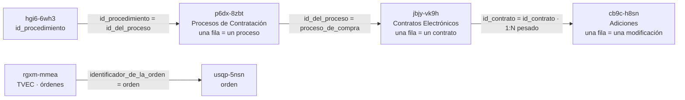

# Fuentes: datasets, unidades de análisis y joins

Lo que el servidor sabe de cada dataset vive en `registry/datasets.py`. SECOP,
DIVIPOLA y criminalidad se verificaron contra la API el 18-ago-2026; las siete
familias de 0.16.0 —empresas, integridad, educación, territorio y macro—, el
05-nov-2026 y revalidado a diario por la suite de
contrato. Esta página es su lectura en prosa.

**Los IDs de Socrata rotan.** `6d52-qyqg` ya devuelve 403. Si uno deja de
responder, búscalo por nombre con `co_datos_buscar_datasets`; no lo des por
muerto.

## La unidad de análisis es lo primero

Cada dataset cuenta una cosa distinta, y sumar filas de dos de ellos produce
cifras sin significado. El servidor la repite en el sobre de cada respuesta por
esto mismo.

| Dataset | Una fila es… |
|---|---|
| `jbjy-vk9h` | un contrato |
| `p6dx-8zbt` | un proceso de compra |
| `cb9c-h8sn` | una modificación contractual |
| `qmzu-gj57` | un proveedor |
| `rpmr-utcd` | un contrato adjudicado |
| `f789-7hwg` | un proceso |
| `9sue-ezhx` | una línea del Plan Anual de Adquisiciones |
| `rgxm-mmea` | una orden de compra |
| `gdxc-w37w` | una entidad territorial |
| `xaxy-8nri` | un centro poblado |
| `vcjz-niiq` | un departamento |

Un proceso puede dar varios contratos, y un contrato puede tener muchas
adiciones: **26,1 M de adiciones para ~5,9 M de contratos**. Contar filas de
`cb9c-h8sn` no cuenta contratos modificados.

## SECOP

### `jbjy-vk9h` — SECOP II · Contratos Electrónicos

85 columnas, **~5,88 M filas**. Es el dataset central del servidor.

| Rol | Columna |
|---|---|
| Identificador | `id_contrato` (forma `CO1.PCCNTR.<n>`) |
| Entidad | `nombre_entidad`, `nit_entidad` |
| Proveedor | `proveedor_adjudicado`, `documento_proveedor` |
| Territorio | `departamento` |
| Modalidad | `modalidad_de_contratacion` |
| Fecha | `fecha_de_firma` |
| Valor | `valor_del_contrato` |
| Enlace | `proceso_de_compra`, `urlproceso` |

- `nit_entidad` es de tipo **number** aquí y **text** en `p6dx-8zbt`: no unir por
  tipo sin convertir.
- **Los contratos en estado `Borrador` están en el dataset.** No están firmados
  —no traen `fecha_de_firma` y su `valor_pagado` es 0— pero sí suman en
  `sum(valor_del_contrato)`. Si lo que quieres es contratación real, filtra por
  estado.
- `urlproceso` llega a veces como objeto JSON con clave `url`, no como cadena.

### `p6dx-8zbt` — SECOP II · Procesos de Contratación

**~9,02 M filas.** Procesos adjudicados y no adjudicados.

Ojo con los nombres: la entidad es `entidad` (no `nombre_entidad`), el
territorio es `departamento_entidad`, el valor es `precio_base` y la fecha es
`fecha_de_publicacion_del` — un slug truncado.

### `cb9c-h8sn` — SECOP II · Adiciones

**26,1 M filas.** Las modificaciones contractuales se llaman **Adiciones**:
buscar «modificaciones» en el catálogo devuelve cero. El join contra contratos
es 1:N y pesado.

Campos: `identificador`, `id_contrato`, `tipo`, `descripcion`, `fecharegistro`.

Sus campos de texto libre son los que **sí** traen el mojibake de origen
(`PRESTACIoN`, `EJECUCIoN`, `MaS`).

### `rpmr-utcd` — SECOP Integrado (I + II)

Solo adjudicados. La vista más simple para análisis que cruce las dos
plataformas. Columnas propias: `nombre_de_la_entidad`, `nit_de_la_entidad`,
`valor_contrato`, `fecha_de_firma_del_contrato`, `origen`.

Aquí viven entidades que no aparecen en `jbjy-vk9h`, como **RTVC**.

### Los demás

| ID | Qué es | Trampa |
|---|---|---|
| `qmzu-gj57` | Proveedores registrados | — |
| `f789-7hwg` | SECOP I · Procesos | Nombres de columna distintos de SECOP II |
| `9sue-ezhx` | Plan Anual de Adquisiciones | **Las columnas de fecha son `text`, no `calendar_date`: no se filtran con `between`** |
| `rgxm-mmea` | Tienda Virtual del Estado (TVEC) | El valor es `total` |

## DIVIPOLA

### `gdxc-w37w` — Municipios

**1.122 filas**: 1.103 municipios + 18 áreas no municipalizadas + 1 isla. No son
«1.122 municipios».

Campos: `cod_dpto`, `dpto`, `cod_mpio`, `nom_mpio`, `tipo_municipio`,
`longitud`, `latitud`.

- Está **atribuido a la Gobernación de Guainía**: es una republicación de
  DIVIPOLA, cuyo origen real es el DANE.
- `longitud`/`latitud` son **text con coma decimal**.
- Los nombres van en mayúsculas **con tildes**: `MEDELLÍN`.

### `xaxy-8nri` — Cabeceras y centros poblados

**8.161 filas**: 1.104 cabeceras municipales (`CM`) + 7.057 centros poblados
(`CP`). Atribución DANE, CC BY-SA 4.0, corte 30-dic-2024.

**Exactamente un registro —Medellín— trae separador de miles en la coordenada**
(`-75,581,775`), y `float(s.replace(",", "."))` lanza `ValueError` sobre él. Es
el caso que `core/coords.py` absorbe y que la suite de contrato vigila.

### `vcjz-niiq` — Departamentos

33 valores. Sin campos clave registrados: se usa como catálogo.

## Joins verificados



Disponibles como recurso MCP en `co://secop/joins`. `usqp-5nsn` y `hgi6-6wh3`
aparecen solo como destino de join: no están en el registro con unidad de
análisis propia.

Fíjate en que **la unidad de análisis cambia en cada salto**: un proceso puede
dar varios contratos y un contrato varias adiciones. Son 26,1 M de adiciones
para ~5,9 M de contratos, así que contar filas después de un join no cuenta
contratos.

**DIVIPOLA es la clave de join universal** entre fuentes territoriales, y los
códigos son **texto con ceros a la izquierda** (`05`, `08`). Tratarlos como
enteros rompe todos los joins.

## Criminalidad · MinDefensa

23 datasets con esquema idéntico: `cod_muni`, `cod_depto`, `municipio`,
`departamento`, `fecha_hecho` y `cantidad`. Verificados contra la API el
18-ago-2026. Todos vienen **ya agregados**: sin nombres, edades ni direcciones.

| Clave | ID | Desde | Casos acumulados | Una fila cuenta… |
|---|---|---|---|---|
| `abigeato` | `p88b-5ac7` | 2003 | 50.083 | una cabeza de ganado hurtada |
| `afectacion_fuerza_publica` | `8rpn-wpty` | 2010 | 25.527 | un miembro de la fuerza pública afectado |
| `delitos_ambientales` | `9zck-qfvc` | 2003 | 86.330 | un delito ambiental |
| `delitos_informaticos` | `4v6r-wu98` | 2006 | 535.034 | un delito informático |
| `delitos_sexuales` | `bz43-8ahq` | 2003 | 453.195 | una víctima de delito sexual |
| `extorsion` | `q2ib-t9am` | 2003 | 132.453 | un caso de extorsión |
| `homicidio` | `m8fd-ahd9` | 2003 | 345.917 | una víctima de homicidio |
| `homicidio_transito` | `uav5-b85g` | 2003 | 128.900 | una víctima en accidente de tránsito |
| `hurto_comercio` | `7i2x-h5vp` | 2003 | 682.898 | un hurto a comercio |
| `hurto_financieras` | `i7h7-wmjc` | 2003 | 2.533 | un hurto a entidad financiera |
| `hurto_personas` | `4rxi-8m8d` | 2003 | 3.801.411 | un hurto a persona |
| `hurto_residencias` | `7mn7-vzqp` | 2003 | 619.378 | un hurto a residencia |
| `hurto_vehiculos` | `csb4-y6v2` | 2003 | 812.279 | un hurto de vehículo |
| `invasion_tierras` | `kvjj-d2ay` | 2003 | 16.216 | un caso de invasión de tierras |
| `lesiones` | `jr6v-i33g` | 2003 | 1.919.771 | una víctima de lesiones personales |
| `lesiones_transito` | `ntej-qq7v` | 2003 | 885.829 | una víctima lesionada en accidente |
| `pirateria_terrestre` | `sutf-7dyz` | 2003 | 10.488 | un caso de piratería terrestre |
| `secuestro` | `d7zw-hpf4` | 2003 | 10.879 | una víctima de secuestro |
| `terrorismo` | `yi5j-5fe9` | 2003 | 15.840 | un hecho terrorista |
| `trata_personas` | `95c7-mm6s` | 2003 | 6.361 | una víctima de trata |
| `violencia_intrafamiliar` | `gepp-dxcs` | 2003 | 1.651.032 | un caso de violencia intrafamiliar |
| `voladura_oleoductos` | `ec2r-4byk` | 2007 | 1.378 | una voladura de oleoducto |
| `voladura_puentes` | `m98b-cdys` | 2003 | 1.351 | una voladura de puente o vía |

`cod_muni` es la clave DIVIPOLA, así que el cruce con geometría o con cualquier
otra fuente territorial es **por código**, sin pasar por el nombre.

### Los 14 datasets que quedan fuera, y por qué

MinDefensa publica **37** con este mismo esquema. Los otros 14 son operativos
del Estado —incautaciones, erradicación, aspersión, minas intervenidas, capturas
por minería ilegal, destrucción de infraestructura— y **no comparten unidad**:

- En `ERRADICACIÓN` (`p72f-qcvk`) la `cantidad` son **hectáreas**: la columna
  `unidad` vale `HECTAREA` en las 145.958 filas.
- En `INCAUTACIONES DE COCAÍNA` (`26zg-9p9r`) la columna `unidad` trae valores
  como `0.002` y `0.003`: son cantidades, no unidades.
- En `MINAS INTERVENIDAS` (`gr35-i7pm`) el `unidad_de_medida` es nulo en las
  15.827 filas.

Sumar eso junto a homicidios sería sumar kilos con personas, así que el registro
no los expone. Una prueba de contrato vigila que la unidad de `ERRADICACIÓN`
siga siendo hectáreas: si algún día se unificara, podrían entrar.

### Tres trampas del dato

**`HURTO A COMERCIO` y `HURTO A RESIDENCIAS` fueron el mismo dataset, y ya no.**
Hasta agosto de 2026 los dos servían 613.637 filas y 614.669 casos, idénticos
año por año; este documento decía «nunca los sumes» y había contrato que lo
comprobaba. MinDefensa recargó sus 23 datasets de criminalidad el **21-oct-2026**
y la duplicación se deshizo: hoy son 682.898 casos en comercio contra 619.378 en
residencias, **sin un solo año en que coincidan**. Sumarlos es legítimo.

El que estaba mal era `HURTO A COMERCIO`. No lo dice la fuente —ningún
changelog acompaña la recarga— sino cómo creció cada cifra: entre el recuento
del 18-ago-2026 y el del 5-nov-2026 los 22 datasets restantes subieron **menos
del 4 %** —el máximo es delitos informáticos, con 3,9 %—, lo que cabe en tres
meses de registros nuevos (homicidio, +0,65 %; residencias, +0,77 %), mientras
comercio subió **11 %**. Ninguna acumulación
explica ese salto; sí lo explica que esa serie sea otra. Así que, hasta octubre
de 2026, `HURTO A COMERCIO` servía los hurtos a residencias.

Esto importa hacia atrás: **una descarga anterior al 21-oct-2026 trae el dato
duplicado**, y cualquier cifra de hurto a comercio publicada antes de esa fecha
es, en realidad, de residencias. El contrato que comprobaba la identidad ahora
comprueba lo contrario, año por año, porque la afirmación que el registro hace
hoy es que son dos series.

**La serie de los dos hurtos se rompe en 2017.** Comercio pasa de 23.060 casos
en 2016 a 60.311 en 2017; residencias, de 24.191 a 46.550. Más que duplicarse en
un año, las dos. No es un artefacto de la recarga ni del registro entero: el
homicidio se queda plano en los mismos años (12.045 y 11.957) y los vehículos
suben 6 %. Una comparación que cruce 2017 —«los hurtos a comercio se
triplicaron desde 2016»— mide la ruptura, no el fenómeno. Las notas del
registro lo advierten en cada consulta y hay contrato que vigila el salto: si
algún día la fuente lo alisa, las notas sobran.

**`cantidad` no siempre vale uno.** Un hecho puede tener varias víctimas:
homicidio tiene 345.195 filas y 345.917 víctimas; violencia intrafamiliar,
675.813 filas y 1.651.032 casos. Se suma `cantidad`, nunca se cuentan filas.

Las cifras de la tabla son del **5-nov-2026** y la serie llega al 30-sep-2026.

## Registro mercantil y societario

### `c82u-588k` — RUES · Personas naturales, jurídicas y ESAL

**9.436.330 filas**, atribución Confecámaras. Es la fuente que las APIs
comerciales venden como «consultar RUES por NIT», y está aquí como dataset
abierto.

Cuatro cosas hay que saber antes de usarla, y las cuatro cambian el resultado:

**Una fila es una matrícula, no una empresa.** 5.091.481 están `CANCELADA` y
3.919.062 `ACTIVA`. «Cuántas empresas hay en Colombia» no se responde contando
filas.

**La mayoría del dataset son personas, no empresas.** `categoria_matricula`
reparte 6.962.889 en `PERSONA NATURAL` y 2.473.441 en
`SOCIEDAD ó PERSONA JURIDICA PRINCIPAL ó ESAL`. **Fíjate en la `ó` acentuada**:
escribirla como una `o` normal devuelve cero filas.

**`clase_identificacion` no discrimina personas.** 517.527 personas naturales
figuran con clase `NIT`. El discriminador fiable es `categoria_matricula`, y de
ahí depende el motor de privacidad: apoyarlo en la clase habría dejado pasar
medio millón de personas como empresas.

**El NIT vive en dos columnas y a veces en ninguna.** En 485.630 sociedades la
columna `nit` está vacía y el número solo aparece en `numero_identificacion`.
SECOLINSA S A S tiene estados financieros en Supersociedades y su `nit` aquí
está en blanco. Toda consulta por documento mira las dos.

Y dos detalles de tipo:

- **`nit` es `text`**: hay que filtrar con comillas (`nit='890903938'`). Sin
  ellas, Socrata responde `query.soql.type-mismatch`.
- **Las fechas son `text` en formato `YYYYMMDD`** (`19841122`), no
  `calendar_date`: `between` no funciona y hay que comparar cadenas.
- **`inscripcion_proponente` vale `000000000000` en 8.563.804 filas.** Parece un
  número de registro en el RUP y casi siempre es un relleno de ceros.

### `nb3d-v3n7` — RUES · Establecimientos, agencias y sucursales

**6.391.836 filas.** Son los puntos de venta, no las sociedades: una sociedad
puede tener decenas y cada una cuenta como fila. Se une por `nit_propietario`.

### `pfdp-zks5` y `prwj-nzxa` — Supersociedades · Estados financieros NIIF

**19.638.408** y **8.091.357 filas**. Formato largo XBRL: una fila por concepto,
empresa y corte, así que **el balance de una empresa son cientos de filas**.

| Trampa | Detalle |
|---|---|
| `periodo` es relativo | Vale «Periodo Actual» o «Periodo Anterior» respecto al radicado, no un año. El año está en `fecha_corte`. Sin fijarlo, cada corte sale duplicado con su comparativo. |
| `valor` es `text` | Hay que castearlo para sumar o comparar. |
| Los conceptos con tilde traen **mojibake de origen** | El byte guardado es U+FFFD, así que `concepto = 'Ganancia (pérdida)'` devuelve **0** filas habiendo 627.932. Se piden con `like 'Ganancia (p_rdida)'`. |
| No todas las empresas están | Los bancos y las aseguradoras reportan a la **Superfinanciera**: Bancolombia no tiene una sola fila aquí. Ausencia no es ausencia de actividad. |

Los conceptos sin tilde sí casan por igualdad: `Total de activos`,
`Total pasivos`, `Patrimonio total`, `Ganancia bruta`,
`Ingresos de actividades ordinarias`, `Costo de ventas`.

### `6cat-2gcs` — Supersociedades · «10.000 Empresas más Grandes»

**50.000 filas, no 10.000**: son 10.000 por año, de 2021 a 2025. Sin fijar
`a_o_de_corte` cada empresa sale cinco veces.

**Los importes son texto con signo de peso y están en billones.** Ecopetrol 2025
figura con `ingresos_operacionales` = `"$ 100.59"`, que son 100,59 billones de
pesos; `total_activos` = `"$ 198.11"`. La fuente no declara la unidad en ninguna
columna: se deduce de contrastar con los estados publicados, y hay prueba de
contrato que lo vigila.

Consecuencia práctica: **`ingresos_operacionales::number` falla** con
`invalid input syntax for type numeric: "$ 100.59"`. Y ordenar por el texto tal
cual es peor, porque es silencioso: `"$ 9.03"` quedaría por encima de
`"$ 100.59"`. Hay que quitar el signo antes de castear:

```sql
ORDER BY replace(replace(ingresos_operacionales, '$ ', ''), ',', '')::number DESC
```

Además, `nit` se sirve como `"899999068.00"` aunque esté declarado `Number`; la
igualdad con el entero (`nit = 899999068`) sí funciona.

## Sanciones y antecedentes

Cinco fuentes, y lo primero que hay que decir de ellas es su tamaño:

| Dataset | Filas | Trae documento | Para qué sirve de verdad |
|---|---|---|---|
| `iaeu-rcn6` · SIRI, Procuraduría | 42.124 | sí | Sanciones a servidores públicos y fuerza pública |
| `4n4q-k399` · SECOP I, multas | 1.716 | **sí** | La única de contratación que se puede cruzar por documento |
| `it5q-hg94` · SECOP II, multas | 588 | no | Casi nada: el 91 % son comentarios positivos |
| `fs36-azrv` · Contadores, JCC | 1.451 | sí | Revisores fiscales sancionados |
| `jr8e-e8tu` · Responsabilidad fiscal, CGR | **60** | sí | Nada: muestra residual parada en 2022 |

**Ninguna consulta del servidor devuelve un cero desnudo sobre estas fuentes.**
Un cero en una base de antecedentes se lee como un certificado limpio, y no lo
es: son extracciones incompletas y con rezago. Los certificados con validez los
expiden la Procuraduría, la Contraloría y la Policía en sus propios portales.

### `iaeu-rcn6` — SIRI

`calidad_persona` reparte las 42.124 sanciones así:

| Calidad | Sanciones |
|---|---|
| Miembro de la fuerza pública | 26.091 |
| Servidor público | 15.736 |
| Particular que ejerce función pública | 143 |
| NA | 128 |
| **Contratista** | **18** |
| Particular | 8 |

De ahí la advertencia que lleva cada respuesta: para verificar a un proveedor
del Estado, SIRI está vacío en la práctica. Es, en cambio, una fuente excelente
para estudiar cómo sanciona el Estado a sus propios funcionarios.

Trae **nombre completo y cédula**, repartidos en cuatro columnas
(`primer_nombre`, `segundo_nombre`, `primer_apellido`, `segundo_apellido`) y
ninguna con el nombre entero: buscar por nombre obliga a mirar las cuatro y
devuelve homónimos. Pasa por el motor de privacidad. Todas las columnas son
`text`, fechas y duraciones incluidas.

### `it5q-hg94` — SECOP II · «Multas y Sanciones»

El título engaña y conviene desglosarlo. `tipo`:

| Tipo | Filas |
|---|---|
| Comentarios positivos | 533 |
| Comentarios negativos | 55 |

Y `estado`:

| Estado | Filas |
|---|---|
| A la espera de aprobación | 379 |
| Publicado por el administrador de la plataforma | **145** |
| Rechazado por el administrador | 33 |
| Borrador | 31 |

Es la tabla de **retroalimentación de proveedores**, no un registro de
sanciones. Contar las 588 filas como sanciones multiplica la cifra por diez. El
servidor filtra a negativos y publicados.

Y `as_codigo_proveedor_objeto` es un **código interno de SECOP**, no el NIT
(`4936100` para ENVIROMENTAL SYSTEMS SAS): no sirve para cruzar con el RUES ni
con los contratos. Esa fuente solo se puede mirar por nombre.

## Educación

### `kgxf-xxbe` — ICFES · Saber 11

**7.109.704 filas de microdato individual**: una por estudiante y aplicación,
con género, fecha de nacimiento, estrato de la vivienda, escolaridad de la madre
y del padre, y si el hogar tiene automóvil, lavadora o internet.

**El servidor solo la expone agregada.** No es que la fila individual esté
bloqueada: no existe el camino. Y `co_educacion_saber11` descarta por defecto
los grupos con menos de 20 estudiantes, porque un promedio sobre tres personas
no es comparable con uno sobre mil y además se acerca a identificar a quien lo
compone.

| Trampa | Detalle |
|---|---|
| Los puntajes son `text` | `punt_global` incluido: hay que castear para promediar. |
| `periodo` mezcla dos poblaciones | Es año+semestre pegados (`20224`). Los acabados en **4** son la aplicación masiva de octubre (~1,1 M de estudiantes); los acabados en **1**, la de marzo (~15 mil, sobre todo repitentes y validantes). `max(periodo)` devuelve a veces la de marzo presentada como «el último año». |
| `punt_global` no es la suma de las áreas | Cada una entra con su propia ponderación. |
| La serie termina en 2022-4 | Sin actualizar desde el 23-ago-2023. |

Y una advertencia que no es técnica: **ordenar colegios por promedio no los
ordena por calidad.** El puntaje correlaciona fuerte con el estrato y la
escolaridad de los padres, que están en la misma fuente; agrupar por `estrato` o
`educacion_madre` lo hace visible en una llamada.

`u37r-hjmu` (Saber Pro) e `iwgf-bkfk` (Saber TyT) son los equivalentes
universitario y técnico, con las mismas reglas.

### `nudc-7mev` — MinEducación · Estadísticas por municipio

**15.707 filas**: ~1.100 municipios por año. Es la **única fuente del servidor
con población municipal**, y es solo la de 5 a 16 años (`poblaci_n_5_16`).

> **No sirve de denominador para tasas de criminalidad.** Es la pregunta que se
> hace sola al verla, y la respuesta es que no: ni es población total ni el rango
> de edad coincide con el de las víctimas.

Los nombres de campo llevan **la tilde comida por el slug**: `a_o`,
`deserci_n`, `poblaci_n_5_16`, `c_digo_municipio`, `tama_o_promedio_de_grupo`.
Los indicadores son porcentajes y vienen como `text` pese a estar declarados
`Number`.

**La cobertura bruta pasa de 100 % con normalidad**: cuenta matriculados de
cualquier edad sobre la población del rango teórico. Medellín 2023 estaba en
107,16 %. La neta es la que no puede pasar de 100.

`c_digo_municipio` es la clave DIVIPOLA, así que cruza con criminalidad y
geometría por código.

## Territorio

### `nkjx-rsq7` — DNP · Medición del Desempeño Municipal

**22.020 filas** en formato largo: 1.101 municipios × 4 indicadores × 5 años
(2016-2020). Los indicadores son `MDM`, `Componente de gestión`,
`Componente de resultados` y `Grupo de dotaciones iniciales`.

**La serie se paró en 2020**, aunque la ficha del dataset diga que se actualizó
el 21-feb-2022. El MDM se sigue publicando cada año: citar esto como «el
desempeño municipal» sin la fecha es citar algo de hace un lustro.

**El MDM solo se compara dentro del mismo grupo de dotaciones iniciales.** Un
municipio con hospital y universidad no parte de donde parte uno sin acueducto,
así que un ranking nacional de mayor a menor mezcla cosas que el índice no
pretende comparar.

**No es TerriData**: el catálogo completo de indicadores territoriales del DNP no
tiene API pública.

## Macro

### `32sa-8pi3` — Superfinanciera · TRM

**8.381 filas.** Una fila puede cubrir **varios días**: la TRM de un viernes
rige sábado y domingo, y `vigenciahasta` lo dice. Preguntar por
`vigenciadesde = '2024-01-21'` —un domingo— devuelve cero habiendo tasa vigente,
que es la del 20 con vigencia hasta el 22. Hay que buscar el rango que contiene
la fecha.

Es la TRM que certifica la Superfinanciera, no una tasa de mercado intradía.

### `axk9-g2nh` — Superfinanciera · Tasas de captación

**2.102.178 filas.** Una fila es lo que **una entidad** reportó en un corte, no
una tasa de mercado: promediar sin ponderar por `monto` da una cifra que no es
la del sistema, porque una entidad pequeña con tasa alta pesa lo mismo que un
banco grande.

Sin filtro, la agregación hace un recorrido completo y agota el tiempo, así que
la herramienta exige al menos `desde` o `descripcion`.

## Lo que no tiene fuente abierta

Está en el registro como `SIN_FUENTE_ABIERTA` y se expone en el *resource*
`co://sin-fuente-abierta`, porque la pregunta se hace sola al ver el resto del
catálogo y la respuesta correcta es decirlo, no buscar un sustituto.

**Población municipal.** El DANE no publica las proyecciones como API. Bajo su
cadena de atribución en `datos.gov.co` hay **exactamente dos datasets**, los dos
de DIVIPOLA; el resto de lo que aparece buscando «proyecciones de población» son
republicaciones de alcaldías sueltas (Chiquinquirá, Sabaneta, Manizales, Guarne).
Sin denominador no hay tasas por 100.000 habitantes. Una prueba de contrato
vigila si eso cambia, porque el día que cambie se puede construir.

**IPC.** Ni el DANE ni el Banco de la República publican sus series por API REST
abierta, y en `datos.gov.co` no están. Sin IPC no hay deflactor, así que los
montos de SECOP siguen siendo nominales. Lo que sí hay es la TRM, que permite
expresar un monto en dólares de la fecha del contrato — una segunda unidad
verificable, no un índice de precios.

**Rama Judicial, Registraduría, RUNT, SIMIT, Boletín de Deudores Morosos.** Solo
se consultan por formulario web con captcha. No entran en un servidor que se
define como «sin credenciales».

## Cadenas de atribución

El facet `attribution` de la Discovery API solo acepta el literal completo:
`attribution=DANE` devuelve cero. `co_datos_buscar_datasets` traduce estas
siglas, y el recurso `co://atribuciones` las expone.

| Sigla | Cadena literal exacta |
|---|---|
| `DANE` | `Departamento Administrativo Nacional de Estadísticas - DANE, Bogotá D.C.` |
| `CCE` | `Agencia Nacional de Contratación Pública - Colombia Compra Eficiente, Bogotá D.C.` |
| `MinDefensa` | `Ministerio de Defensa Nacional - MinDefensa, Bogotá D.C.` |
| `Fiscalía` | `Fiscalía General de la Nación, Bogotá D.C.` |
| `MinTIC` | `Ministerio de Tecnologías de la Información y las Comunicaciones - MinTIC, Bogotá D.C.` |
| `Confecámaras` | `Confecámaras, Bogotá D.C.` |
| `Supersociedades` | `Superintendencia de Sociedades SuperSociedades, Bogotá D.C.` |
| `Superfinanciera` | `Superintendencia Financiera de Colombia - SUPERFINANCIERA, Bogotá D.C.` |
| `Procuraduría` | `Procuraduría General de la Nación, Bogotá D.C.` |
| `Contraloría` | `Contraloría General de la República, Bogotá D.C.` |
| `ICFES` | `Instituto Colombiano para la Evaluación de la Educación - ICFES, Bogotá D.C.` |
| `MinEducación` | `Ministerio de Educación Nacional MinEducación, Bogotá, D.C` |
| `DNP` | `Departamento Nacional de Planeación DNP, Bogotá D.C` |
| `JCC` | `Unidad Administrativa Especial Junta Central de Contadores - JCC, Bogotá D.C.` |

Fíjate en `Estadísticas` **en plural**: no es el nombre real de la entidad, pero
es el literal que exige el facet.

## Alias de entidad

`co_secop_resolver_entidad` traduce estas siglas a un fragmento que sí aparece
en `nombre_entidad` de `jbjy-vk9h`:

| Sigla | Fragmento |
|---|---|
| `DANE` | `DEPARTAMENTO ADMINISTRATIVO NACIONAL DE ESTADISTICA` |
| `IGAC` | `INSTITUTO GEOGRAFICO AGUSTIN CODAZZI` |
| `ICBF` | `INSTITUTO COLOMBIANO DE BIENESTAR FAMILIAR` |
| `SENA` | `SERVICIO NACIONAL DE APRENDIZAJE` |
| `INVIAS` | `INVIAS` |
| `DIAN` | `DIRECCION DE IMPUESTOS Y ADUANAS NACIONALES` |
| `ANLA` | `AUTORIDAD NACIONAL DE LICENCIAS AMBIENTALES` |
| `UNGRD` | `UNGRD` |

**INVIAS y UNGRD figuran con su sigla y nada más.** Expandirlas a su razón
social daba cero; es el error que la suite de contrato vigila a diario.
